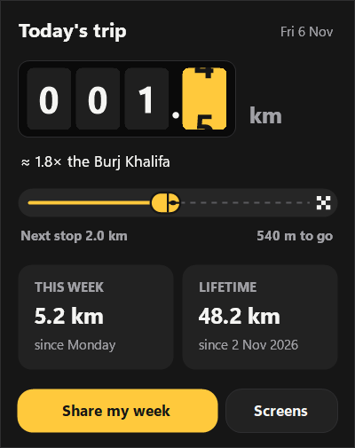
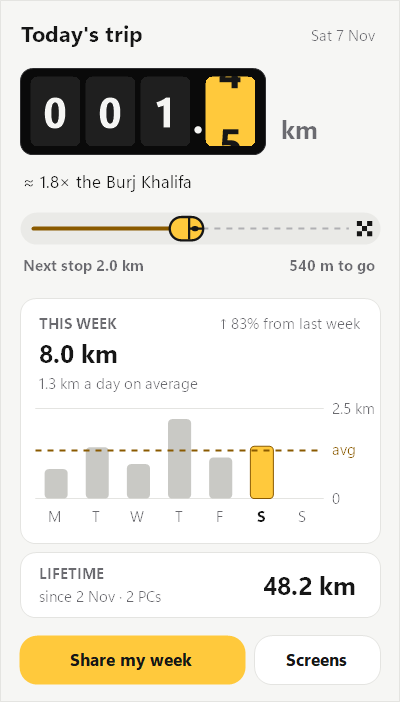
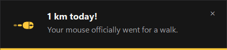
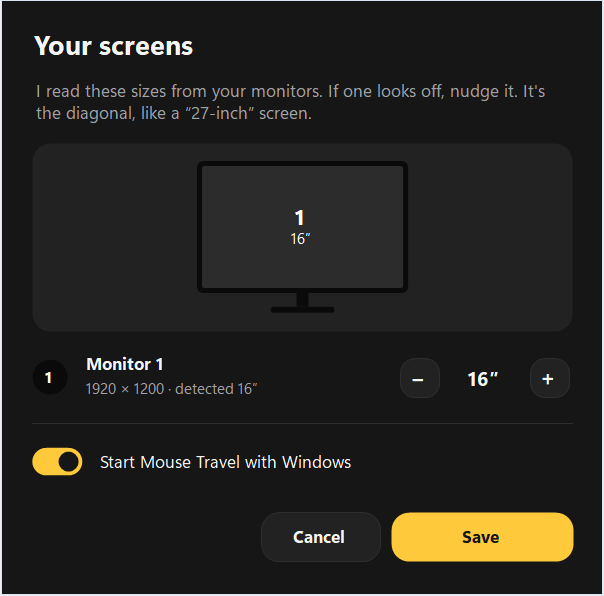

# Mouse Travel

A tiny Windows tray app that turns your mouse movement into meters and kilometers, shown on a rolling car odometer.

<p>
  
  
</p>

- **Lives in the system tray:** a few MB of RAM, a single small `.exe`, no installer, no extra runtime
- **A rolling odometer** for today's trip, a little road to your next milestone, and your **lifetime** distance
- **Milestone pop-ups** at 500 m and 1 km, then every km after that, plus lifetime ones like "half marathon". They're Mouse Travel's own cards, so they work even with Windows notifications off, never steal focus, and wait while you're in a full-screen app.
- **A weekly share card:** a 1080×1080 image saved to `Pictures\Mouse Travel` and copied to your clipboard
- **Automatic screen detection** of each monitor's real size (adjust anytime under **Screens**)
- Follows Windows **light/dark mode** and the **Animation effects** setting




## Download
Grab `MouseTravel.exe` from the [latest release](../../releases/latest) and double-click it. That's it.

Windows SmartScreen may warn you the first time because the app isn't code-signed. Click **More info → Run anyway**.

## Use it
- **Left-click** the little yellow mouse in the tray to see today, this week and lifetime totals
- **Right-click** for share, screens, start with Windows, and quit
- Hover over the tray icon for a quick "today · lifetime" readout

The numbers are deliberately rough: it measures how far the cursor travels across your screens, using each screen's physical size.



## Your data
Stored only on your PC. Nothing is sent anywhere.

- **`Mouse Travel history.txt`**, next to `MouseTravel.exe`: a plain notepad file with every day, this week and your lifetime total. It's refreshed every minute and on every start, and Mouse Travel reads it back as a backup.
- **`%APPDATA%\MouseTravel`**: the app's own data (`days.csv`, one line per day), a `backup` folder with a copy for each of the last 7 days, and a small `log.txt`.

Saving never lowers a day's distance: before writing, Mouse Travel merges what's already on disk and in the history file. To move or back up your history, copy the history file (or the AppData folder).

## Build from source
Requires Windows 10 or 11, nothing else. This uses the C# compiler that ships with Windows (.NET Framework 4.x):

```
powershell -ExecutionPolicy Bypass -File build.ps1
```

The whole app is in [`src/MouseTravel.cs`](src/MouseTravel.cs).
